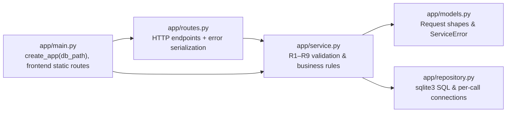

# RoomBook Backend Implementation Plan (R1–R10)

## Goal Description

Implement the RoomBook study-room booking backend in `app/` to satisfy [docs/spec.md](file:///home/ben/code/CS%20690/Assignment-5-main/docs/spec.md) (rules R1–R10, decisions P1–P4 and D1–D3) and the architecture/layer rules in [AGENTS.md](file:///home/ben/code/CS%20690/Assignment-5-main/AGENTS.md) and [tools/check_layers.py](file:///home/ben/code/CS%20690/Assignment-5-main/tools/check_layers.py). All existing tests in `tests/acceptance/` must pass without modification, and nothing in `frontend/` may be changed.

## Architecture Overview



Layer constraints enforced by `tools/check_layers.py`:
- **L1**: Only `app/repository.py` imports `sqlite3` or contains SQL strings.
- **L2**: Only `app/routes.py` and `app/main.py` import `fastapi` or `starlette`.
- **L3**: `app/routes.py` does not import `app.repository` (calls `app.service`).
- **L4**: `app/main.py`, `app/routes.py`, `app/service.py`, `app/repository.py`, and `app/models.py` all exist, and `app/main.py` defines `create_app`.
- **L5**: No ORM or third-party database library anywhere in `app/`.

---

## Task 1: `app/repository.py`

### Files Created
- **[NEW]** `app/repository.py`

### Implementation Details
- **Database connection helper**: Use `contextlib.closing(sqlite3.connect(db_path))` paired with `with conn:` so every repository call opens a fresh thread-safe connection, commits/rolls back the transaction, and closes the connection cleanly before returning. Set `conn.row_factory = sqlite3.Row`.
- **Schema & idempotent room seeding (`init_db(db_path: str) -> None`)**:
  - `CREATE TABLE IF NOT EXISTS rooms (id INTEGER PRIMARY KEY, name TEXT NOT NULL, capacity INTEGER NOT NULL)`
  - `CREATE TABLE IF NOT EXISTS bookings (id INTEGER PRIMARY KEY AUTOINCREMENT, room_id INTEGER NOT NULL, date TEXT NOT NULL, start TEXT NOT NULL, end TEXT NOT NULL, booked_by TEXT NOT NULL)` — `AUTOINCREMENT` enforces D3 so deleted booking IDs are never reused.
  - Seed the 4 fixed rooms from spec section 2 via `INSERT OR IGNORE INTO rooms (id, name, capacity) VALUES ...` so repeated calls to `create_app` on the same `db_path` never duplicate rooms (R10).
- **Data access functions** (returning plain `dict` / `bool` so Task 1 has no dependency on `app/models.py`):
  - `list_rooms(db_path: str) -> list[dict]`: `SELECT id, name, capacity FROM rooms ORDER BY id ASC`.
  - `room_exists(db_path: str, room_id: int) -> bool`: `SELECT 1 FROM rooms WHERE id = ?`.
  - `list_bookings(db_path: str, date: str, room_id: int | None = None) -> list[dict]`: query by `date` (and optional `room_id`), ordered by `room_id ASC, start ASC` (R2).
  - `has_overlap(db_path: str, room_id: int, date: str, start: str, end: str) -> bool`: check `EXISTS` where `room_id = ? AND date = ? AND start < ? AND ? < end` (each starts before the other ends, so touching slots do not overlap per R7).
  - `create_booking(db_path: str, room_id: int, date: str, start: str, end: str, booked_by: str) -> dict`: `INSERT INTO bookings (...) VALUES (...)` and return the 6-field booking dict with `cursor.lastrowid`.
  - `delete_booking(db_path: str, booking_id: int) -> bool`: `DELETE FROM bookings WHERE id = ?`, returning `cursor.rowcount > 0`.

### What "Done" Means
- `app/repository.py` exists, contains all SQL and `sqlite3` usage, opens and closes a new connection per call, uses `AUTOINCREMENT` for `bookings.id`, and passes a direct Python smoke check for table creation, idempotent room seeding, CRUD, and overlap queries.
- `python tools/check_layers.py` reports no L1, L2, L3, or L5 violations on `app/repository.py` (L4 still reports the four remaining modules as missing until Tasks 2–3).
- **Acceptance tests passing after Task 1**: **None (0)** — `tests/conftest.py` imports `app.main.create_app`, which is created in Task 3, so all acceptance tests continue to error with `No module named 'app.main'`.

---

## Task 2: `app/models.py` and `app/service.py`

### Files Created
- **[NEW]** `app/models.py`
- **[NEW]** `app/service.py`

### Implementation Details
- **`app/models.py`** (standard-library `dataclasses` only; no `sqlite3`, no `fastapi`/`starlette`, no Pydantic coercion):
  - `CreateBookingRequest` dataclass (`room_id: int`, `date: str`, `start: str`, `end: str`, `booked_by: str`).
  - `ServiceError(Exception)` carrying `status_code: int`, `error: str`, and `message: str` so `routes.py` can serialize every domain error into the R9 two-field JSON body `{"error": ..., "message": ...}`.
- **`app/service.py`** (enforces all rules in spec section 5; delegates persistence to `app.repository`):
  - `init_db(db_path: str) -> None`: delegates to `repository.init_db(db_path)` so `app/main.py` does not need to touch SQL or repository internals directly.
  - `list_rooms(db_path: str) -> list[dict]` (**R1**): returns the 4 rooms ordered by `id`.
  - `list_bookings(db_path: str, date: str | None, room_id: str | None) -> list[dict]` (**R2**):
    - Validate `date` is present and matches `^\d{4}-\d{2}-\d{2}$` and is a valid calendar date (`datetime.date.fromisoformat`), else raise `ServiceError(422, "invalid_request", ...)`.
    - If `room_id` is provided (`room_id is not None`), validate it matches `^-?\d+$` (rejecting `""`, `"1.5"`, `"abc"`, `"true"` with `422 invalid_request`), convert to `int`, and check `repository.room_exists(db_path, room_id_int)` (else `404 room_not_found`).
  - `create_booking(db_path: str, payload: object) -> dict` (**R3–R7, R9, P1–P2, P4, D2**):
    Enforce strictly in R9 precedence order:
    1. **R3 (`422 invalid_request`)**: `payload` is a `dict`; all 5 keys (`room_id`, `date`, `start`, `end`, `booked_by`) are present; `room_id` is `int` and `not isinstance(room_id, bool)`; `date`, `start`, `end`, `booked_by` are `str`; `date` is `YYYY-MM-DD` and a real calendar date; `start` and `end` match `^\d{2}:\d{2}$` with hour `00..23` and minute `00..59`. Ignore extra keys (R3/P2). Construct `CreateBookingRequest`.
    2. **R4 (`422 invalid_name`)**: strip whitespace from `booked_by`; require `1 <= len(trimmed) <= 40`.
    3. **R5 (`422 invalid_time`)**: minutes of `start` and `end` in `{"00", "30"}`; `start >= "08:00"` and `end <= "22:00"`; `start < end`; duration `<= 180` minutes.
    4. **R6 (`404 room_not_found`)**: check `repository.room_exists(db_path, req.room_id)`.
    5. **R7 (`409 overlap`)**: check `not repository.has_overlap(db_path, req.room_id, req.date, req.start, req.end)`.
    6. Persist via `repository.create_booking(...)` using the trimmed `booked_by`.
  - `cancel_booking(db_path: str, raw_booking_id: str) -> None` (**R8, P3**):
    - Validate `raw_booking_id` matches `^-?\d+$` (else `422 invalid_request`).
    - Call `repository.delete_booking(db_path, int(raw_booking_id))`; if `False`, raise `404 booking_not_found`.

### What "Done" Means
- `app/models.py` and `app/service.py` exist, contain zero SQL/`sqlite3` (L1) and zero `fastapi`/`starlette` imports (L2), and enforce R1–R9 in exact precedence order with unit/smoke verification of rule logic.
- **Acceptance tests passing after Task 2**: **None (0)** — `app/routes.py` and `app/main.py` do not exist yet, so `tests/acceptance/` still errors with `No module named 'app.main'`.

---

## Task 3: `app/routes.py` and `app/main.py`

### Files Created
- **[NEW]** `app/routes.py`
- **[NEW]** `app/main.py`

### Implementation Details
- **`app/routes.py`** (HTTP handling only; imports `fastapi` and `app.service`/`app.models`, never `app.repository`):
  - `router = APIRouter()`
  - Helper `_db_path(request: Request) -> str` reading `request.app.state.db_path`.
  - `GET /api/rooms` -> `200`, calls `service.list_rooms(db_path)`.
  - `GET /api/bookings` -> accepts `date: str | None = None` and `room_id: str | None = None` as optional query params so FastAPI does not intercept missing/non-integer params with its default `422` schema; calls `service.list_bookings(db_path, date, room_id)`.
  - `POST /api/bookings` -> parses raw body with `await request.json()`, raising `ServiceError(422, "invalid_request", ...)` on `json.JSONDecodeError`/`UnicodeDecodeError` (or non-JSON body); calls `service.create_booking(db_path, payload)`; returns `JSONResponse(status_code=201, content=booking)`.
  - `DELETE /api/bookings/{booking_id}` -> accepts `booking_id: str` so non-integer IDs (e.g., `"abc"`, `"1.5"`) reach `service.cancel_booking(db_path, booking_id)` and produce R9 `422 invalid_request`; returns `Response(status_code=204)`.
- **`app/main.py`**:
  - Defines `create_app(db_path: str = "roombook.db") -> FastAPI` (exact spec section 3 signature).
  - Initializes database via `service.init_db(db_path)` and stores `app.state.db_path = db_path`.
  - Registers exception handlers:
    - `ServiceError` -> `JSONResponse(status_code=exc.status_code, content={"error": exc.error, "message": exc.message})` (R9).
    - `RequestValidationError` (safety fallback) -> `JSONResponse(status_code=422, content={"error": "invalid_request", "message": "Invalid request."})`.
  - Serves frontend assets from `<repo_root>/frontend/` using `FileResponse`:
    - `GET /` -> `frontend/index.html`
    - `GET /app.js` -> `frontend/app.js`
    - `GET /styles.css` -> `frontend/styles.css`
  - Includes `router` from `app/routes.py`.

### What "Done" Means
- All five required modules (`app/main.py`, `app/routes.py`, `app/service.py`, `app/repository.py`, `app/models.py`) exist and `create_app` matches section 3.
- `python tools/check_layers.py` passes with exit code 0 (`Layer check passed: L1 to L5 hold.`).
- **Acceptance tests passing after Task 3**: **All tests** in `tests/acceptance/` pass (`test_r1_r2_read.py`, `test_r3_r6_create_validation.py`, `test_r7_r8_bookings_lifecycle.py`, `test_r9_r10_errors_and_app.py`) with zero edits to `tests/acceptance/` and zero edits to `frontend/`.

---

## Verification Plan

### Automated Verification
After each task, run:
```bash
python tools/check_layers.py
python -m pytest tests/acceptance
```
After Task 3, also run the full test suite:
```bash
python -m pytest
```

### Manual Verification
Start the server and verify the UI in a browser at `http://localhost:8000`:
```bash
uvicorn app.main:create_app --factory --port 8000
```

---

## Not in this change

- **R11 / `daily_limit`**: `frontend/app.js` defines a `MESSAGES.daily_limit` entry, which is outside `docs/spec.md` sections 1–6 (reserved for Part 8) and is not implemented here.
- **Authentication / authorization / booking ownership**: No user accounts, login, or cancel-permission checks (spec section 1 and P3).
- **Room capacity enforcement**: Room `capacity` is returned by `GET /api/rooms` for display only and is never checked on booking creation (P2).
- **Past-date restrictions**: Bookings for dates before today are allowed (P1).
- **Edits to `frontend/`, `tests/acceptance/`, `tests/conftest.py`, `legacy/`, or `tools/`**: Explicitly excluded; all acceptance tests must pass unmodified.
- **ORMs or extra packages**: Only Python standard library (`sqlite3`, `dataclasses`, `datetime`, `re`, `contextlib`, `pathlib`, `json`) and packages already in `requirements.txt` (`fastapi`, `uvicorn`) are used.
- **Extra endpoints, fields, or error codes**: Only the 5 API endpoints, 3 frontend static routes, 6 booking fields, 3 room fields, and 6 error codes in `docs/spec.md` sections 3–6 are implemented.
